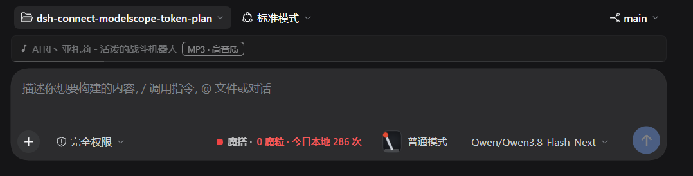

# dsh-connect-modelscope-token-plan

把魔搭社区（modelscope.cn）**API-Inference 免费额度**的面板接进 DeepSeek Harness 的 **Plugins 页**（插件卡内联，三个 tab：额度 / 模型 / 接入），并可选把魔搭模型注册成 **DSH 的 LLM provider**（id `modelscope-token-plan`，OpenAI 兼容）——注册后魔搭模型进 DSH 模型选择器，可直接对话调用；还能开**出图工具**做文生图 / 图生图。

姊妹插件：`dsh-connect-sensenova-token-plan`、`dsh-connect-agnes-token-plan`（同族结构）。

> **三条先知道（省得装完才发现）**
>
> 1. **只要一枚 API Key，不要登录**：魔搭访问令牌（形如 `ms-…`，在魔搭「个人中心 > 访问令牌」生成），无 OAuth、无密码、无刷新。`MODELSCOPE_API_KEY` 环境变量只在 DSH 启动时读一次、且优先级高于面板保存值——所以**最省事是直接在面板「接入」tab 保存令牌**（立即生效，不依赖重启）。
> 2. **面板头条是官方魔粒余额（真实值）**；本地计数只统计**经本插件的调用**，且**按 profile（客户端）分段**——桌面端与 Web 端各记各的账、互不可见（`npm run doctor` 并排列出各 profile）。它不是跨端总量。
> 3. **接入 provider 与出图工具都默认关**：不打开时插件就是个额度看板；打开任一项失败，面板照常用、只是该模块缺席。

## 面板长什么样

三个 tab：**额度 / 模型 / 接入**。

**「额度」tab**——头条是官方魔粒余额（真实值），下面接本地调用分布与趋势图（竖向柱状，可切**显示天数**：默认 / 7 / 14 / 30 / 90）：


- 本地计数只回答官方余额答不了的问题——按模型分布、本地趋势、429 事件流；它**只读不到时画「—」**，绝不会把「不知道」画成 0。
- 本地计数**按 profile 分段**（本客户端口径）：桌面端与 Web 端是两个 profile，各有各的状态目录，互不可见；直连魔搭的其它客户端不计入。

**「模型」tab**——模型按厂商分组、勾选即启用，顶部可搜索；开关「接入为 DSH 模型」即把魔搭注册为 DSH provider，模型进入 DSH 选择器：


- 同一 tab 下方有**「出图工具」**卡：开启后支持文生图、图生图与多图编辑。它与「接入为 DSH 模型」是两条独立开关，开关值立即保存、**工具的挂载发生在下次 Host 启动**。出图是异步的：一次没出好会返回 `status: pending` 与 `jobId`，带上它再调一次即可续查（不必重出）。协议细节见 [docs/SPIKE-image-gen.md](docs/SPIKE-image-gen.md)（2026-10-10 实测，v0.2 起已实现）。
- 卡片底部有**「上下文窗口覆盖」**选择器（不覆盖 / 128K / 256K / 512K / 1M）：魔搭目录不返回窗口字段，插件按「目录声明 → 你选的档位 → 内置策展表（models.dev 交叉真值）→ 128K 兜底」四级兜底；覆盖压过策展表。档位来源与「为什么不给输出上限内置策展表」见 [docs/PROVIDER-M4.md](docs/PROVIDER-M4.md)。

**「接入」tab**——粘贴一枚 `ms-…` 访问令牌即完成凭据配置（令牌永不入日志、永不进插件目录）。没有令牌时面板会提示你到这里来填。

## 对话框胶囊（v0.2 起）

注册 provider 之后，输入框工具栏会多一枚用量胶囊，不用打开 Plugins 页也能看到额度：

```
魔搭 · 143 魔粒 · 今日本地 7 次
```

实际长这样（输入框工具栏，不用开 Plugins 页）：



- 前半是官方魔粒余额（与面板头条同一个数）；后半是**今日本地调用次数**（只统计经本插件的调用）——两个数字来源不同，所以后段必须带「本地」。
- **只在当前选中的 provider 是 `modelscope-token-plan` 时出现**，切到别的 provider 整块消失、不发任何请求。
- **没有百分比、没有黄色档**：魔粒是存量、官方没有发布上限或低额阈值，造进度条 / 阈值都是给沒人公布过的分母配数。三档只有绿（正）/ 红（官方确为 0）/ 灰（读不到）。
- **读不到 ≠ 0**：读不到时该段渲染「—」，0 只在官方真的给 0 时出现并走告警色；读失败保留上次数值并标「上次数据」。

## 安装

1. 在 DSH「插件」页搜索 `dsh-connect-modelscope-token-plan` 点击安装，或运行：

   ```bash
   dsh plugin --profile web add dsh-connect-modelscope-token-plan       # Web 端
   dsh plugin --profile desktop add dsh-connect-modelscope-token-plan  # 桌面端
   ```

2. **完全退出 DSH（含托盘）再启动**。

3. 打开 DSH 的 **Plugins 页**，找到本插件的插件卡（面板是页内联卡片，**不在侧边栏**）。

> 装到 npm 的那一份**不含 `docs/`**（`package.json` 的 `files` 白名单只带 `lib/` / `client.js` / `assets/` / `README.md` / `CHANGELOG.md` / `LICENSE` 等），下文指向 `docs/*` 的链接在已安装副本上打不开，请到 GitHub 仓库看。

## 免费额度怎么算（2026-10 快照，以官方为准）

- 每日免费调用次数按账户计（当前约 2000 次/天，需绑定阿里云 + 实名；规则多次调整过）；
- 单模型另有每日上限（社区数据约 500 次/天）与每分钟限频；
- 额度按天重置；耗尽返回 429。
- `/v1/models` 免认证可读，**不消耗额度**。

上面这些数字来自社区公开信息、非官方数据，官方调整后需手动更新本节；**它们只用于解释「额度怎么算」，不参与任何计算**——面板不消费次数上限，「还剩几次」算不出来。

## 运维诊断：这台机器现在开没开 provider？

provider / 出图 / 上下文窗口的生效值存在插件私有状态文件里，不在任何配置或路由上，按 profile 分段。查「到底开没开」用 doctor，它只读状态文件、不碰凭据，Host 没起也能跑：

```bash
npm run doctor          # 人读：每个 profile 的 provider / draw 开关与模型清单
npm run doctor:json     # 机器读：JSON（可进你的巡检 / 工单脚本）
```

## 诚实声明

- 面板头条是**官方魔粒余额**（真实值）；本地计数只统计**本客户端（本 profile）内经本插件的调用**——它回答分布/趋势/429 事件流，不是余额，且桌面端与 Web 端各记各的、互不可见（迁移窗口期旧共享布局以 `shared (legacy)` 报出）。读不到时渲染「—」，不是 0。
- **本地计数与 harness 全局账本刻意不合并**：DSH 自己的 `@linxin666/dsh-usage` 只记成功调用的 token、且失败一次都不记；本插件只补它答不了的两件事——① 经本插件的分布与趋势；② **429 / 错误事件流**（官方只给总额度余额，不给「哪个模型刚才在限频」，这是本插件的独家数据）。
- 429 / 错误事件读的是 `llm-error-fix` 重分类之后的 code；观察层套在重分类层之外，顺序不可反。
- **单模型「额度耗尽」是推断，不是读数**：官方只有账户级魔粒余额，没有 per-model 额度端点；最近一次真耗尽落在推断窗口内时 picker 不再提供它、面板灰显禁勾选，事件移出窗口即恢复（恢复不可观测是已知代价）。判定见 [docs/PROVIDER-M4.md](docs/PROVIDER-M4.md) §15。
- 计数口径：每次流结束记一次 call，**含失败、含用户中断**；token 数上游没给时是 `null` 而非 0。重试各记一次（魔搭按次数计费，每次重发都真打了一次上游；完整论述见 `src/host/usage-observer.ts`）。
- **provider 默认关**（opt-in）：面板「模型」tab 的「接入为 DSH 模型」开关翻转即生效，面板保存值优先于 `cordis.patch.yml` 的默认。
- **已知限制：`reasoning` 恒为 false**：本插件保守默认不发 `reasoning_effort`（模型用自己的默认），也不提供思考强度选择器——值不被校验、且无法区分「生效」与「静默忽略」。完整论证见 [docs/PROVIDER-M4.md](docs/PROVIDER-M4.md) §4。
- **输出上限默认是 harness 的 32768，不是魔搭声明的数**：魔搭 `/v1/models` 从不返回输出上限字段，本插件策略是「目录声明了才声明」，所以每个模型的 descriptor 都不带 `maxTokens`，harness 用缺省 32768 兜底；面板「最大输出」徽章显示生效值，**没带徽章 = 正在吃 32768 兜底**。精确覆盖在 `cordis.patch.yml` 的 `maxTokensOverrides`。为什么不像上下文窗口那样内置策展表：平台从不声明、也没逐模型实测，策展一张「猜能吐多少」的表就是在编数字（详见 [docs/PROVIDER-M4.md](docs/PROVIDER-M4.md)）。
- 次数口径的「推算剩余 / 参考上限」已从面板移除（官方改魔粒计费后两个单位并排是误导），配置里的 `dailyQuotaTotal` / `dailyQuotaPerModel` 两个社区快照常数也一并删除——面板不消费它们，留着只会让人以为能算「还剩几次」。
- 429 响应形状未实测，解析按 OpenAI 惯例兼容，漂移时面板给 `shapeWarnings`。
- 面板「模型」tab 的每个模型外链到其魔搭详情页（单价只在网页展示、不在官方 API），所以只是**人工核对用的跳转，不是数据源**。

## 文档

- [docs/SPIKE.md](docs/SPIKE.md) — 上游到底有没有额度信号（实测记录 + 结论）
- [docs/SPIKE-image-gen.md](docs/SPIKE-image-gen.md) — 出图协议实测（2026-10-10；v0.2 起已实现）
- [docs/PROVIDER-M4.md](docs/PROVIDER-M4.md) — provider 接入实现契约（设计裁定都在这里）
- [docs/IMPLEMENTATION.md](docs/IMPLEMENTATION.md) — 这版怎么做出来的、踩过什么坑
- [docs/REFERENCES.md](docs/REFERENCES.md)、[docs/REFERENCE-modelsdev.md](docs/REFERENCE-modelsdev.md) — 上游端点全景 / 第三方方案对比
- [docs/ROADMAP.md](docs/ROADMAP.md) — v1 要做什么、做到哪了
- [docs/archive/](docs/archive/) — 已冻结的逐版修复档案

AI 协作会话请先读 [AGENTS.md](AGENTS.md)（验证入口、红线与文档地图）；开发者校验工具（变异测试 / 覆盖率）见 [tools/dev/README.md](tools/dev/README.md)；发布流程见 [RELEASING.md](RELEASING.md)。

## 许可证

MIT License，全文见 [LICENSE](LICENSE)。
