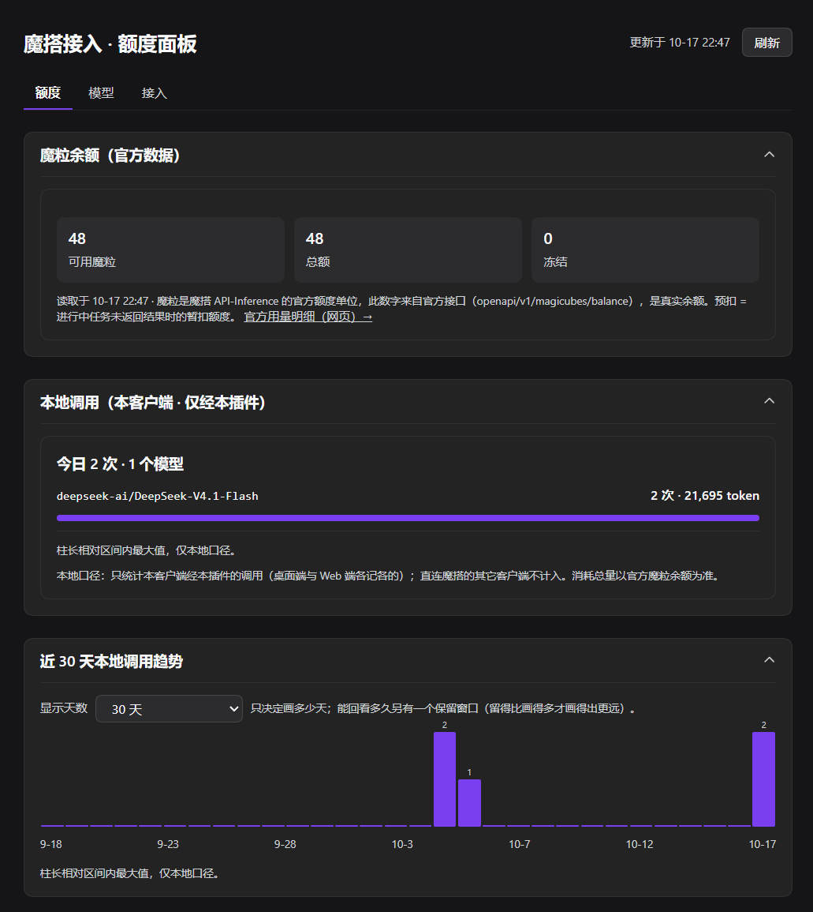
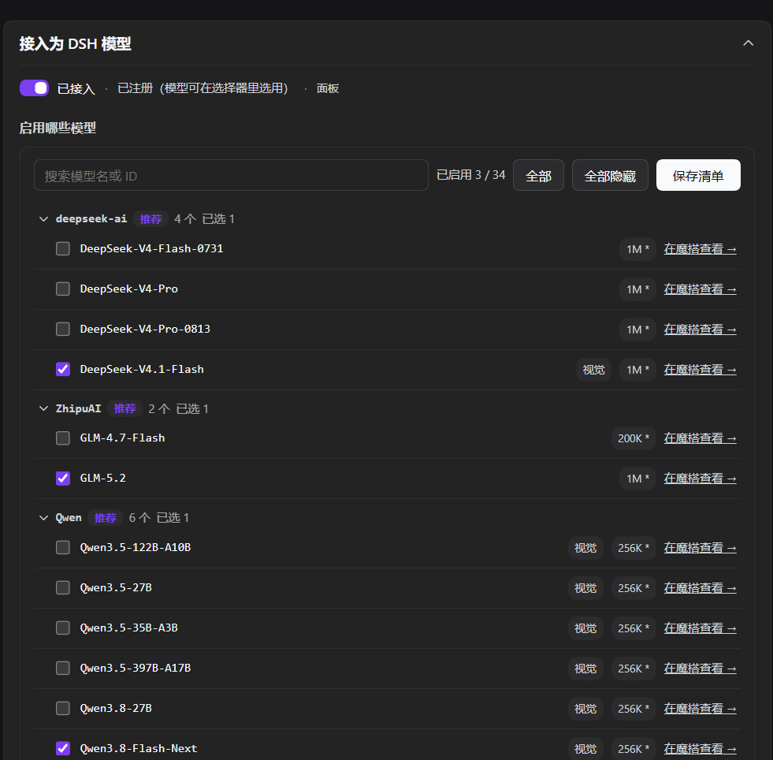

# dsh-connect-modelscope-token-plan

把魔搭社区（modelscope.cn）**API-Inference 免费额度**的本地用量面板接入 DeepSeek Harness 的 Plugins 页（插件卡内联，三个 tab：额度 / 模型 / 接入），并可选把魔搭注册成 **DSH 的 LLM provider**（id `modelscope-token-plan`，直连 `apiBase`，OpenAI 兼容）——注册后魔搭模型进入 DSH 模型选择器，可直接对话调用。见 [docs/PROVIDER-M4.md](docs/PROVIDER-M4.md)。

姊妹插件：`dsh-connect-sensenova-token-plan`、`dsh-connect-agnes-token-plan`（同族结构，受控复制）。

**状态：M4 已落地（provider 注册 + 面板「接入为 DSH 模型」），离线测试与 typecheck/build 全绿。**

## 面板长什么样

三个 tab：**额度 / 模型 / 接入**。

**「额度」tab**——头条是官方魔粒余额（真实值），下面接本地调用分布与趋势图：



趋势图是**竖向柱状图**（每根柱顶标出当天次数、0 次不标；轴约 7 个日期刻度且不带年份），区块内可切**显示天数**（默认 / 7 / 14 / 30 / 90）。这个选择器只决定「画多少天」，与决定「能回看多久」的**保留窗口**（`retentionDays`，默认 90 天）是两件事——显示窗口恒被夹在保留窗口之内，所以不会出现「把已剪掉的日子画成 0」那种与「那天真的没调用」无法区分的形状。选择保存在 `usage-prefs.json`（按 profile 分段）。

**「模型」tab**——一行一个魔搭模型，可勾选启用；开关打开即把魔搭注册为 DSH provider：



同一 tab 下方另有**「出图工具」**卡（v0.2 起）：开启后 Host 给 agent 注册
`modelscope_draw_image`，支持文生图、图生图与多图编辑。**它与「接入为 DSH 模型」
是两条独立开关**，且开关值立即保存、而工具的**挂载发生在下次 Host 启动**（peer 的
tools registry 没有 unregister）。实测协议（异步两段式、必需头、提交态不可信、
计费与耗时口径）见 [docs/SPIKE-image-gen.md](docs/SPIKE-image-gen.md)。

工具本身也是**两段式**的（v0.4 起）：一次调用只等 `drawWaitMs`（默认 90 秒）——
图好了直接返回，没好就返回 `status: pending` 与一个 `jobId`，**带上它再调用即可
继续查询**（只查询、不重复出图）。上游排队实测 1–15 分钟，此前一次调用会一直
await 到出图为止，整轮对话都得陪着等。

同一 tab 下方另有**「上下文窗口」**选择器（默认/128K/256K/512K/1M）：魔搭目录
`/v1/models` 不返回窗口字段，Host 侧按三级真值链给每个模型定窗口——目录真声明了
就用目录值（不受任何下层影响）；用户在这里选一个档位即对**目录没声明窗口的模型**
全局生效，保存即重注册；**用户没设覆盖时**，插件查内置策展表（`context-catalog.ts`，
来自 models.dev 各厂 host 交叉比对的同 id 主流窗口，2026-10-16 核对，含 DeepSeek-V4
全系 1M、Qwen3.5/Qwen3.8-27B/Step 3.x 256K、GLM-5.2 1M 等 19 个当前目录 id）；
表里也没有的模型才落 128K 兜底。档位落盘在 `provider.json` 的 `contextWindow` 键
（v1 形状的新增可选键，旧构建宽容读），roster 每行会标出该模型当前生效的窗口——
策展表来的值带 `*` 号与悬停说明（平台未亲口声明），与目录声明/用户覆盖区分。

## 对话框胶囊（v0.2 起）

注册 provider 之后，输入框工具栏会多一枚胶囊（用户不需要打开 Plugins 页就能看见额度）：

```
魔搭 · 143 魔粒 · 今日本地 7 次
```

- **前半**是官方魔粒余额（`balance.available`，真实值，与面板头条同一个数）；**后半**是今日本地调用次数（Host 侧本地日桶，只统计经本插件的调用）。两个数字来源不同，所以后段必须带「本地」——官方接口没有「今日」这一项，不写清就会被读成官方计数。
- **只在会话当前选中的 provider 是 `modelscope-token-plan` 时出现**（读宿主 session 作用域的 `modelSelection` 投影），切到别的 provider 即整块消失，且一个请求都不发。
- **没有百分比、没有黄色档**。魔粒余额是**存量**、官方没有发布任何上限或低额阈值：画进度条或定一个「低于 N 魔粒算黄」的阈值，都是给一个没人公布过的分母配数。三档只有绿（读数是正数）/ 红（官方读数确实是 0）/ 灰（读不到）。
- **读不到 ≠ 0**（与面板同一条纪律）：读不到时该段渲染「—」，0 只在官方真的给了 0 时出现并走告警色；读失败保留上一次的数值，并标「上次数据」（阈值 = Host 声明的 `pollSeconds` × 3）。tooltip 里带余额时间、失败原文与本地计数缺失的原因。

## 三条事实（写代码前先认清）

1. **官方有「魔粒」余额端点**：`GET {siteBase}/openapi/v1/magicubes/balance`（Bearer 访问令牌，匿名 401），返回 `{success, data:{total_balance, available_balance, frozen_amount}}`（2026-10-04 实测，见 [docs/SPIKE.md](docs/SPIKE.md)）。推理响应本身仍不带任何额度头。
2. **本地计数是辅助口径**：面板头条是官方魔粒余额；本地计数只回答官方余额答不了的问题——按模型分布、本地趋势、429 事件流（只统计经本插件的调用，直连魔搭的其它客户端不计入）。次数口径的「推算剩余/参考上限」已从面板移除（官方改魔粒计费后两个单位并排是误导），相应的 `dailyQuotaTotal` / `dailyQuotaPerModel` 两个社区快照常数也从配置里一并删除了——面板不消费它们，留着只会让人以为能算「还剩几次」。
3. **凭据只有一把静态钥匙**：魔搭访问令牌（个人中心生成，形如 `ms-…`），无 OIDC、无密码、无 refresh。默认读 DSH 凭据服务已有的 `MODELSCOPE_API_KEY` 引用；`MODELSCOPE_API_KEY` 环境变量只在启动时读一次，且优先级高于存储值（坑见下段）；令牌永不入日志、永不进插件目录。

   **凭据分层有个坑（2026-10-05 实测）**：DSH 凭据服务的优先级里，**启动时的环境快照压过存储文件**，而那个快照**在启动时冻结**（不是活的 `process.env`）。两个后果：①在 DSH 启动**之后**改环境变量——包括 Windows 用户级变量——**不会被看见**，改完必须**完全重启 DSH**（退出全部 `DeepSeek Harness` 进程，不只是关窗口）才进快照；②重启让环境变量生效后，它会**反过来压过面板里保存的值**，而面板仍显示「已保存」。**最省事的做法是直接在面板里保存令牌**（立即生效，且不依赖重启）。

## 免费额度怎么算（2026-10 快照，以官方为准）

- 每日免费调用次数按账户计（当前约 2000 次/天，需绑定阿里云 + 实名；规则多次调整过）；
- 单模型另有每日上限（社区数据约 500 次/天）与每分钟限频；
- 额度按天重置；耗尽返回 429。
- `/v1/models` 免认证可读，**不消耗额度**。

上面这些数字来自社区公开信息，非官方数据，官方调整后需手动更新本节；**它们只用于解释
「额度怎么算」，不参与任何计算**——面板不消费次数上限，「还剩几次」算不出来（见下节）。

## 文档地图

| 何时 | 查 |
|---|---|
| 「上游到底有没有额度信号」 | [docs/SPIKE.md](docs/SPIKE.md)（实测记录 + 结论） |
| 「能不能接生图、协议是什么」 | [docs/SPIKE-image-gen.md](docs/SPIKE-image-gen.md)（2026-10-10 实测；**v0.2 起已实现**，承上表体例） |
| provider 怎么接入（写代码前） | [docs/PROVIDER-M4.md](docs/PROVIDER-M4.md)（实现契约） |
| **这版是怎么做出来的、踩过什么坑** | [docs/IMPLEMENTATION.md](docs/IMPLEMENTATION.md)（0.1.0 / M4 实施过程档案） |
| v0.2.0 的十二轮修复细节（已冻结，非入门路径） | [docs/archive/2026-10-05-closeout.md](docs/archive/2026-10-05-closeout.md) |
| 上游端点全景 / 第三方方案对比 | [docs/REFERENCES.md](docs/REFERENCES.md)、[docs/REFERENCE-modelsdev.md](docs/REFERENCE-modelsdev.md) |
| v1 要做什么、做到哪了 | [docs/ROADMAP.md](docs/ROADMAP.md) |
| Host/Client 两半怎么分 | [docs/PROVIDER-M4.md](docs/PROVIDER-M4.md)（§14 红线）＋ [docs/IMPLEMENTATION.md](docs/IMPLEMENTATION.md)；本仓库暂无独立的 `ARCHITECTURE.md` |
| 开发者校验工具（变异测试 / 覆盖率） | [tools/dev/README.md](tools/dev/README.md)；发布流程见 [RELEASING.md](RELEASING.md) |

## 诚实声明

- 面板头条是**官方魔粒余额**（真实值）；本地计数只统计**经本插件的调用**——它回答的是分布/趋势/429 事件流，不是余额，直连魔搭的其它客户端不计入。注册 provider 之后，DSH 的全部魔搭调用都经本插件，所以本地计数**覆盖全部 DSH 魔搭调用**。次数口径的「推算剩余」已从面板移除（官方改魔粒计费后两单位并排是误导），相应地`quota.daily` 只剩 `usedLocal` 一个数——没有 `limit`，也没有推算出的「剩余」。这个数还有第三种答案：**本地计数文件读不到时它是 `null`，面板渲染「—」**——「今日 0 次」是可信的日常值，把「我不知道」画成它会让人以为今天没调用过（`usage.json` 损坏、形状不对、或被更新的构建写过都是这种情形，原因会在面板上方的漂移提示里说明）。
- **本地计数的口径与 harness 全局账本不同，且刻意不合并**。DSH 自己有 `@linxin666/dsh-usage`，按 `days→provider→model` 记成功调用的 token；它只订阅 session 的 `assistant/message`，**失败调用一次都不记**。所以本插件只做两件全局账本答不了的事：①「经本插件的调用分布与趋势」；②**429/错误事件流**——这是本插件的独家数据（官方只给总额度余额，不给「哪个模型刚才在限频」）。成功的 token 总量不在此重复记账（详见 `src/host/usage-observer.ts` 文件头）。
- 429/错误事件的分类读的是 **`llm-error-fix` 重分类之后**的 code：被误判成 QUOTA 的 rpm 限频在事件流里记作 `rate_limit`，与退避策略说同一件事。观察层套在重分类层**之外**，顺序不可反。
- **计数口径**：每次流结束记一次 call，**含失败、含用户中断**（魔搭按次数计费，限频掉的请求同样是一次调用）；token 数上游没给时是 `null` 而非 0。偏差方向是**按流计次**：重试不在流内部发生，而是在流消费完后由 `agent/request-error` 瀑布决定重发，因而**每次重试各记一次**——按「魔搭按次数计费」的口径这反而是对的（每次重发都真打了一次上游）。
- **provider 默认关**（opt-in，与姊妹插件一致）：面板「模型」tab 的「接入为 DSH 模型」开关翻转即生效，面板保存值优先于 `cordis.patch.yml` 的 `registerProvider` 默认。
- **已知限制：`reasoning` 恒为 false**。魔搭 API-Inference 是多模型代理，是否吃 `reasoning_effort` 取决于背后那个模型，本插件保守默认不发该参数（模型用自己的默认），也不提供思考强度选择器。**原理由「发错档位会整条请求 400」已在 2026-10-05 真机探测中证伪**：`reasoning_effort` 传 `"bogus"` 同样返回 200，值不被校验。真实障碍是无法区分「生效」与「静默忽略」（都是 200），且该端点会在真响应与空壳 200 之间摇摆——档位表做不出来，不是没做。见 [docs/PROVIDER-M4.md](docs/PROVIDER-M4.md) §4。
- 429 响应形状未实测（不值得烧额度去触发），解析按 OpenAI 惯例兼容，漂移时面板会给 `shapeWarnings`。
- 面板「模型」tab 的每个模型都外链到其魔搭详情页（`https://www.modelscope.cn/models/{owner}/{model}`）：魔粒单价只在网页展示、不在官方 API，所以这只是一个**人工核对用的跳转，不是数据源**（「为什么没有按模型消耗 API」见 [docs/REFERENCES.md](docs/REFERENCES.md)）。
